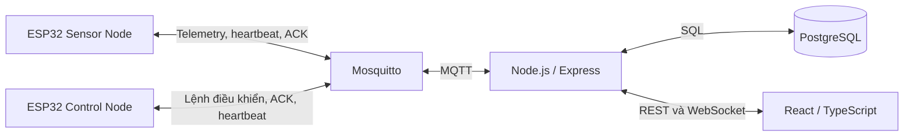

# Hệ thống phòng học thông minh

Hệ thống IoT dùng hai ESP32 để giám sát môi trường phòng học và điều khiển đèn, quạt. Giao diện web hiển thị số đo theo thời gian thực, lịch sử, cảnh báo và trạng thái thiết bị. Người dùng có quyền phù hợp có thể gửi lệnh thủ công hoặc thiết lập quy tắc tự động theo số đo.

## Kiến trúc



- **Sensor Node** đọc nhiệt độ và độ ẩm từ DHT22, độ rọi từ BH1750, chuyển động từ PIR và hiển thị số đo trên OLED. Khi mất mạng, node giữ mẫu trong LittleFS để gửi lại khi kết nối phục hồi.
- **Control Node** nhận lệnh MQTT, đóng hoặc ngắt relay đèn và quạt, rồi gửi ACK. Backend lưu trạng thái mong muốn và trạng thái thiết bị báo về trong Device Shadow.
- **Backend** xác thực người dùng và thiết bị, xử lý telemetry, quản lý vòng đời thiết bị, cảnh báo và tự động hóa. PostgreSQL lưu số đo, cấu hình, lệnh và nhật ký.
- **Frontend** tải dữ liệu qua REST và cập nhật qua WebSocket. Backend giới hạn thao tác theo vai trò Admin, Operator, Viewer và phạm vi phòng học được cấp.

## Cấu trúc repository theo mục 8.1

| Đường dẫn | Nội dung |
| --- | --- |
| [README.md](README.md) | Giới thiệu, kiến trúc, cài đặt và cách chạy hệ thống. |
| [firmware/](firmware/) | Sketch Arduino cho ESP32 Sensor Node và Control Node, mã dùng chung, đồng bộ offline và cập nhật OTA. |
| [backend/](backend/) | REST API, xử lý telemetry, MQTT, WebSocket, quản lý phòng học và thiết bị. |
| [frontend/](frontend/) | Dashboard web React, TypeScript và Vite. |
| [database/](database/) | Migration SQL có phiên bản để tạo và cập nhật lược đồ PostgreSQL. |
| [deployment/](deployment/) | Docker Compose, Dockerfile, cấu hình Mosquitto và script triển khai. |
| [hardware/](hardware/) | Danh sách linh kiện, sơ đồ nối dây và hình minh họa phần cứng trong báo cáo. |
| [tests/](tests/) | Kiểm thử đơn vị, tích hợp, trình duyệt và kịch bản kiểm thử phần cứng. |
| [docs/](docs/) | Đặc tả giao tiếp, hướng dẫn vận hành và tài liệu tính năng nâng cao. |
| [.env.example](.env.example) | Biến môi trường backend và Docker Compose với giá trị mẫu. |

## Cài đặt và chạy cục bộ

Cần Git, Node.js 22 hoặc 24 kèm npm, Docker Desktop hoặc Docker Engine có Compose. Các lệnh dưới đây dùng PowerShell và chạy từ thư mục gốc.

### 1. Cài đặt và khởi động backend

```powershell
git clone https://github.com/Phuxt162005/IoT_He_thong_phong_hoc_thong_minh.git
cd IoT_He_thong_phong_hoc_thong_minh
npm ci
npm run setup:local
docker compose --env-file .env -f deployment/compose.yml --profile app up -d --build --wait backend
npm run smoke
```

`setup:local` sinh `.env`, `.env.test` và khóa công khai OTA cho bản cài mới. Nếu đã cấu hình dự án, bỏ qua bước này và giữ các thông số đang dùng cho PostgreSQL và Mosquitto. Compose tự chạy migration, tạo tài khoản quản trị ban đầu và thiết lập quyền MQTT trước khi mở backend.

Backend có địa chỉ `http://localhost:3000`. `GET /health` kiểm tra tiến trình và `GET /ready` kiểm tra kết nối dịch vụ cùng trạng thái migration. Xem [hướng dẫn vận hành](docs/backend-operations.md) để chạy backend bằng Node ngoài Docker, cấu hình mạng và sao lưu.

### 2. Khởi động dashboard

Chạy trong một cửa sổ PowerShell khác, tại thư mục gốc.

```powershell
npm --prefix frontend ci
if (!(Test-Path frontend/.env)) { Copy-Item frontend/.env.example frontend/.env }
npm --prefix frontend run dev -- --strictPort
```

Mở `http://localhost:5173` và đăng nhập bằng `ADMIN_USERNAME` và `ADMIN_PASSWORD` trong `.env` gốc. Mẫu `frontend/.env.example` đặt `VITE_USE_MOCK=false`, API tại `http://localhost:3000/api/v1` và WebSocket tại `ws://localhost:3000/ws`. Giữ frontend ở cổng `5173` hoặc bổ sung origin tương ứng vào `CORS_ORIGINS` của backend.

### 3. Chạy thử với thiết bị mô phỏng

```powershell
npm run demo:backend
```

Lệnh này tạo phòng và hai thiết bị mô phỏng, gửi dữ liệu qua Mosquitto rồi lưu lịch sử vào PostgreSQL. Mở Telemetry và chọn phòng demo để xem mẫu đã ghi. Khi kịch bản kết thúc, các node mô phỏng được thu hồi và phòng chuyển sang `INACTIVE`.

### 4. Kết nối ESP32

1. Lắp mạch theo [sơ đồ và bảng chân](hardware/README.md). Dùng Arduino IDE, cài ESP32 Arduino core `3.2.1` và chọn board phù hợp. Workflow build dùng `ESP32 Dev Module` với `esp32:esp32:esp32`.
2. Cài các thư viện ArduinoJson, PubSubClient, DHT sensor library, Adafruit Unified Sensor, BH1750, Adafruit GFX Library và Adafruit SSD1306. Xem phiên bản trong [workflow firmware](.github/workflows/firmware.yml).
3. Tạo phòng và đăng ký từng node trên dashboard. Chọn **Provision** để cấp thông tin xác thực MQTT. Trong thư mục mỗi node, sao chép `Config.h.example` thành `Config.h` và điền Wi-Fi, mã phòng, mã thiết bị, username và mật khẩu MQTT được cấp.
4. Đặt `MQTT_HOST` là IP LAN của máy chạy Mosquitto và `MQTT_PORT` là cổng MQTT phía máy chủ, mặc định `1884`. Cho ESP32 và máy chủ dùng mạng có thể truy cập lẫn nhau.
5. Mở `sensor_node.ino` hoặc `control_node.ino` trong thư mục tương ứng, nạp vào đúng ESP32 và mở Serial Monitor ở `115200` baud. Sensor Node cần phân vùng filesystem có thể mount bằng LittleFS.
6. Khi node hiển thị `ONLINE` và đã gửi heartbeat, chọn **Kích hoạt**. Kiểm tra số đo, trạng thái relay và ACK theo [kịch bản kiểm thử phần cứng](tests/hardware-test-scenarios.md).

## Kiểm thử

```powershell
npm test
docker compose --env-file .env -f deployment/compose.yml --profile test up -d --wait db-test mqtt-test
npm run mqtt:bootstrap:test
npm run test:integration
npm --prefix frontend run build
```

Kiểm thử tích hợp dùng PostgreSQL và Mosquitto riêng, theo cấu hình `.env.test`. Xem [README frontend](frontend/README.md#kiểm-thử-giao-diện-tích-hợp) để chạy kiểm thử trình duyệt và [kịch bản phần cứng](tests/hardware-test-scenarios.md) để nghiệm thu cảm biến, relay và đồng bộ khi mất mạng.

## Tài liệu

- [Đặc tả HTTP OpenAPI](docs/openapi.json), [hợp đồng MQTT](docs/backend-contracts.md) và [ghi chú triển khai backend](docs/backend-notes.md#dashboard-dữ-liệu-và-realtime-be-14) có chi tiết WebSocket.
- [Tài liệu nâng cao](docs/advanced/) gồm Device Shadow, đồng bộ offline, Monitoring và Logging, phát hiện bất thường và OTA.

Chỉ đưa các mẫu cấu hình lên GitHub. Giữ `.env`, `.env.test`, `Config.h` và khóa riêng OTA ở môi trường cục bộ hoặc trong hệ thống quản lý bí mật.
