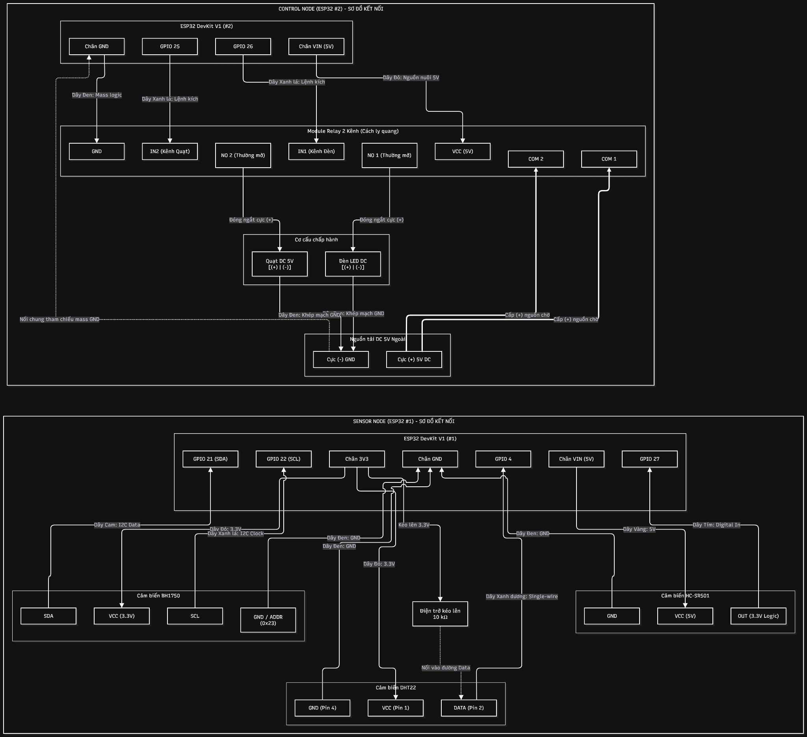
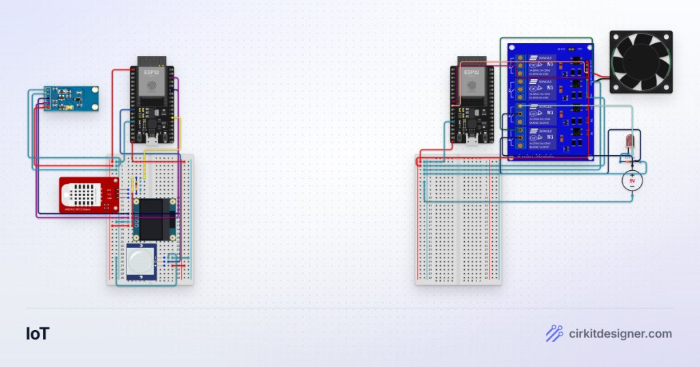
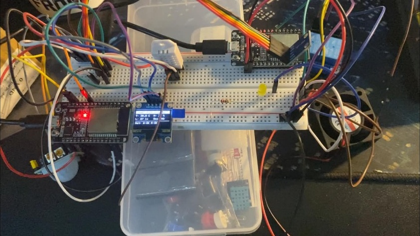
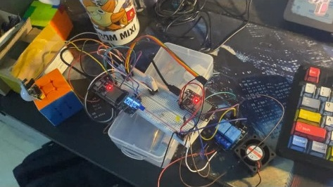

# Phần cứng phòng học thông minh

Mô hình dùng hai ESP32 DevKit. Sensor Node đo môi trường và hiển thị số đo trên OLED. Control Node điều khiển hai tải DC qua relay.

## Danh sách linh kiện

| Linh kiện | Số lượng | Công dụng |
| --- | ---: | --- |
| ESP32 DevKit | 2 | Một bo cho Sensor Node, một bo cho Control Node. |
| DHT22 | 1 | Đo nhiệt độ và độ ẩm. DHT22 dạng rời cần điện trở kéo lên 10 kΩ cho DATA. |
| BH1750 | 1 | Đo độ rọi qua I²C. |
| PIR HC-SR501 | 1 | Phát hiện chuyển động. |
| OLED SSD1306 I²C 128 × 64 | 1 | Hiển thị số đo, trạng thái Wi-Fi/MQTT và hàng đợi. |
| Module relay hai kênh | 1 | Đóng ngắt đèn và quạt. Chọn module nhận được tín hiệu điều khiển 3,3 V từ ESP32. |
| Đèn LED DC và quạt DC | 1 mỗi loại | Tải thử nghiệm. Dùng nguồn phù hợp với điện áp và dòng định mức của tải. |
| Cáp USB, dây nối, breadboard và nguồn DC | Theo mô hình | Cấp nguồn và lắp thử mạch. |

## Nối dây theo firmware

### Sensor Node

| Linh kiện | Chân tín hiệu | Nguồn và kết nối phụ |
| --- | --- | --- |
| DHT22 | DATA → GPIO 4 | VCC → 3V3, GND → GND. Với cảm biến rời, mắc điện trở 10 kΩ giữa DATA và 3V3. |
| BH1750 | SDA → GPIO 21, SCL → GPIO 22 | VCC → 3V3, GND → GND. Firmware thử địa chỉ `0x23`, sau đó `0x5C`. |
| OLED SSD1306 | SDA → GPIO 21, SCL → GPIO 22 | Dùng chung bus I²C với BH1750. Firmware dùng địa chỉ `0x3C`. Cấp nguồn phù hợp với module, giữ mức tín hiệu I²C ở 3,3 V. |
| PIR HC-SR501 | OUT → GPIO 27 | VCC → 5 V, GND → GND. Kiểm tra mức OUT phù hợp với GPIO ESP32. |

Xem [cấu hình Sensor Node](../firmware/sensor_node/Config.h.example).

### Control Node

| Chân ESP32 | Kết nối |
| --- | --- |
| GPIO 25 | Chân IN của kênh relay đóng ngắt quạt (FAN). |
| GPIO 26 | Chân IN của kênh relay đóng ngắt đèn (LIGHT). |
| GND | GND phía tín hiệu của module theo sơ đồ nhà sản xuất. |

`RELAY_ACTIVE_LOW=true` trong [cấu hình Control Node](../firmware/control_node/Config.h.example) tương ứng với module kích mức thấp. Cấp nguồn relay theo module đang dùng. Với mỗi tải DC trong mô hình, nối dương nguồn vào COM, nối NO vào dương tải và nối âm tải về âm nguồn. Dùng tải DC điện áp thấp khi kiểm thử.

### Sơ đồ từ báo cáo thiết kế

Hình 6.8 trích từ báo cáo thiết kế. Bảng chân phía trên bổ sung OLED và xác định kênh theo tải đèn/quạt trong cấu hình firmware.

### Sơ đồ lắp mạch minh họa (Cirkit Designer)

Hình trên là sơ đồ lắp mạch minh họa dựng trên **Cirkit Designer**, bổ sung đầy đủ **màn hình OLED SSD1306** cùng **DHT22**, **BH1750**, **PIR HC-SR501** trên **Sensor Node** (trái) và mạch điều khiển **quạt DC / đèn LED** qua relay kèm nguồn `5 V` ngoài trên **Control Node** (phải; thư viện minh họa sử dụng module relay 4 kênh và đấu nối 2 kênh cho `FAN` và `LIGHT`, khi thi công thực tế dùng module relay 2 kênh như danh sách linh kiện ở trên).

## Ảnh prototype thực tế

### Cận cảnh hai node và màn hình OLED đang hoạt động

Sensor Node (`ESP32` phía dưới trái) hiển thị số đo môi trường và trạng thái kết nối `Net: W:OK M:OK` trên OLED SSD1306, kết nối DHT22, PIR HC-SR501 và BH1750; Control Node (`ESP32` phía trên phải) điều khiển đèn LED vàng và quạt DC qua module relay 2 kênh.

### Toàn cảnh mô hình thử nghiệm

Ảnh toàn cảnh mô hình 2 ESP32 đang cấp nguồn vận hành thực tế cùng module relay 2 kênh xanh và tải quạt DC, phù hợp với [kịch bản kiểm thử phần cứng](../tests/hardware-test-scenarios.md).
